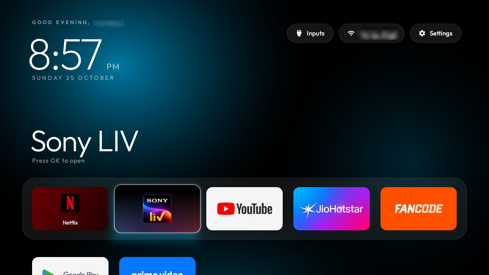
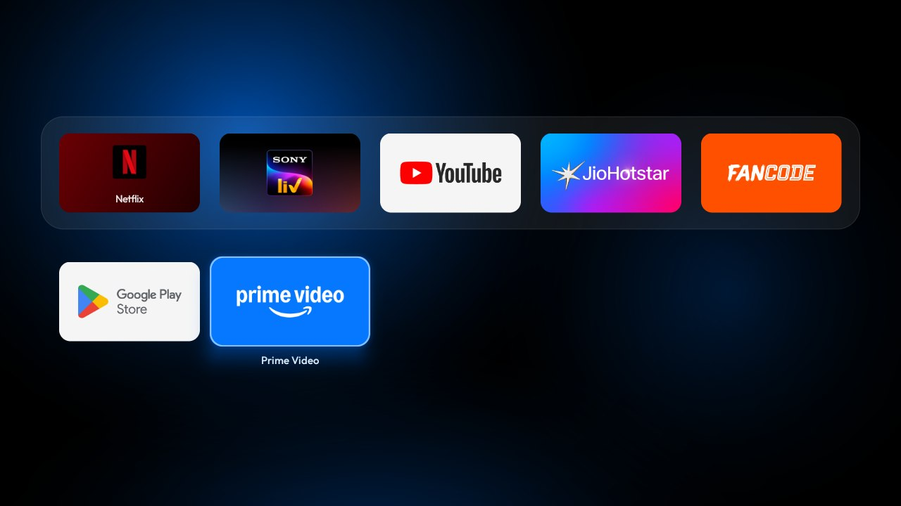
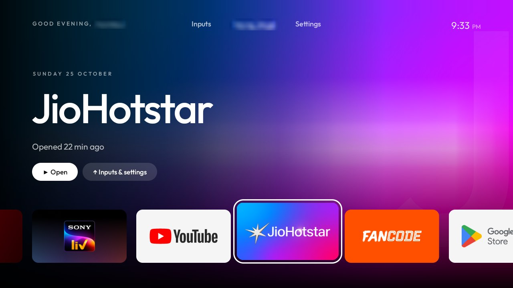
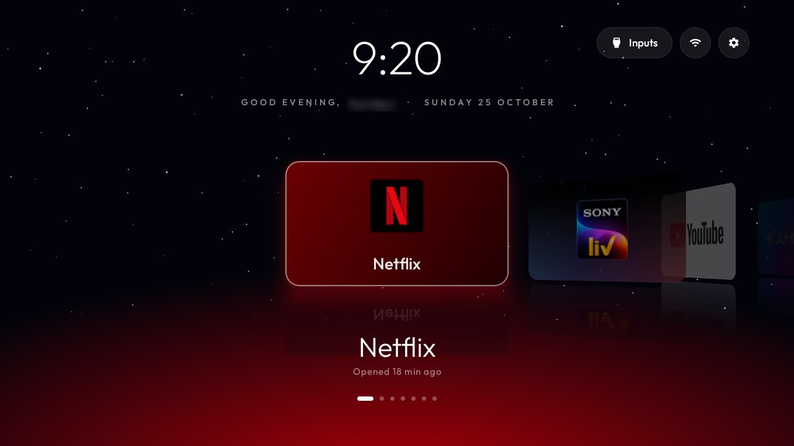

# Home styles fork

This fork adds three Home styles to the cleanyourtv launcher: **Aurora**, **Cinema** and **Orbit**. The original
layout stays as **Classic**. Switch between them on the TV: in the new styles, OK on the **Settings** pill opens a
quick panel with **Launcher settings**; in Classic, hold OK on Settings. Then pick **Home style**. Everything else
in the repo (prompt, debloat lists, tools, themes) is upstream's, unchanged.

Built and tested on a **Xiaomi Mi TV 4i (MiTV4I, Amlogic, 1 GB RAM), Android TV 9**, firmware PI.3698.

| | |
|---|---|
|  |  |
| **Aurora**: soft light in the focused app's colours drifts behind a frosted dock; the focused tile springs up with a slight 3D tilt toward the direction you moved, a sheen sweeps across it and it casts a glow in its own colour. Down scrolls into the grid, one row per press | |
|  |  |
| **Cinema**: the focused app's own artwork, washed into a soft full-screen backdrop that slowly zooms, a giant faint initial, the app's name in large type and a ribbon of tiles along the bottom | **Orbit**: the apps on a curved 3D carousel with mirror reflections, over a quietly twinkling star field and a horizon that glows in the focused app's colour |

## What the three styles share

- **Opening an app** grows a panel in the app's colour from its tile to the whole screen while the app starts, so
  a slow start reads as part of the motion instead of a frozen Home.
- **UI sounds**: a tick per move, a soft thunk at an edge, a rising whoosh when an app opens, a pop for menus.
  Synthesised once into static `AudioTrack`s at start (no sound files, nothing decoded per press). Off with
  Launcher settings > **UI sounds**, or `ui_sounds` in `config.xml`.
- **"Opened 2 hours ago"** under the focused app, for apps opened from Home.
- **Deterministic D-pad**: Left/Right stop at the ends with a small bump, Up from the apps always reaches the top
  bar, Down from the top bar returns to the app you left, Back returns to the apps.
- Inputs, the network pill and Settings call the classic layout's own buttons, so the Inputs menu, the HDMI
  switching and the quick panel behave exactly as upstream.

## How it fits in the launcher

The classic layout keeps running underneath (it still loads the apps, owns Home and runs the remote helpers) but
is not drawn. A style is a plain `FrameLayout` over it that reads the loaded tiles from `AppAdapter` and takes the
D-pad, OK and Back; every other key (volume, Home, Menu) goes on to `MainActivity` as before.

| File | What it is |
|---|---|
| `StyleHome.java` | The shared base: 1280x720 design canvas scaled to the screen, clock, tile building, the launch zoom, text swaps, edge bumps, the soft colour "wash" |
| `AuroraHome.java`, `CinemaHome.java`, `OrbitHome.java` | The three styles |
| `UiSounds.java` | The synthesised sounds |
| `MainActivity.java`, `AppAdapter.java`, `LauncherSettingsActivity.java` | Small hooks: create the chosen style, forward lifecycle and keys, a few tile accessors, the picker |

Within upstream's limits for 1 GB TVs: **no blur** (Cinema's soft backdrop is the app's artwork shrunk to a few
pixels and scaled back up, which GPU bilinear filtering turns into a blur-like wash), **no video, no network, no
new permissions, no new dependencies, no background services**. Ambient motion is property animation only and
stops when Home is not on screen; the star field redraws at most about 12 times a second. Memory on the Mi TV 4i:
about 27 MB PSS for the whole launcher with a style on. Release APK about 536 KB, under upstream's 576 KB gate.
Lint is at zero errors and the unit tests pass.

## Settings

| Key (`config.xml`) | Values |
|---|---|
| `home_style` | `classic`, `aurora` (this fork's default), `cinema` or `orbit`. The on-TV choice wins and survives reinstalls |
| `ui_sounds` | `true` (default) or `false` |

## Install

Same as upstream: run the prompt in [PROMPT.md](PROMPT.md) with this fork cloned, or build and install directly
with `TV_HOST=<tv ip> launcher/build-and-install.sh` (`launcher\build-and-install.ps1 -TvHost <tv ip>` on Windows).

## Known limits

- The three styles are laid out left to right; Hebrew and Arabic get translated labels but not a mirrored layout.
- Coloured glows under raised tiles need Android 9; on Android 8 the shadow is plain.
- Module cards show as ordinary tiles in the styles, and the app library, reorder mode and tile menu are only in
  Classic (switch to Classic, reorder, switch back: the styles follow the saved order).
- Issues: [github.com/YuvrajSingh808/cleanyourtv/issues](https://github.com/YuvrajSingh808/cleanyourtv/issues).
